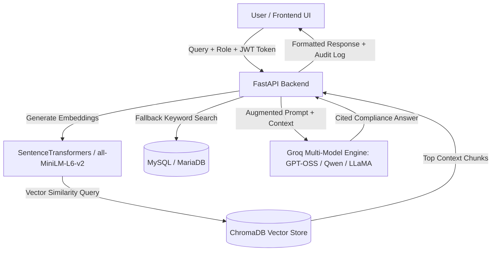

# 🏎️ BAJA RuleBot - Intelligent Rulebook Assistant & Compliance Engine

[](https://python.org)
[](https://fastapi.tiangolo.com)
[](https://mysql.com)
[](https://www.trychroma.com/)
[](https://groq.com)
[](https://jwt.io)
[](https://tailwindcss.com)

> **An AI-powered Retrieval-Augmented Generation (RAG) compliance assistant designed specifically for BAJA SAEINDIA collegiate engineering teams, faculty advisors, and technical inspectors.**

---

## 📌 Executive Summary

**BAJA SAEINDIA** is an intercollegiate engineering design competition where student teams build rugged, single-seat, off-road vehicles. With a rulebook spanning over 120+ pages of dense technical, electrical, safety, and administrative specifications, manual verification is time-consuming and error-prone.

**BAJA RuleBot** solves this by providing:
1. **Instant, Role-Tailored Answers**: Adapts responses to Team Captains, Faculty Advisors, Finance Managers, Department Managers, and Technical Members.
2. **Strict Grounding & Zero Hallucination**: Employs sliding-window semantic chunking with overlap and vector search with ChromaDB and high-performance Groq LLMs to cite exact rule sections.
3. **Dynamic Inspection Checklists**: Generates actionable, itemized checklists with persistence for technical scrutiny.
4. **Enterprise-Grade Security**: Features PBKDF2-HMAC password hashing, HMAC-SHA256 JWT bearer token authentication, IDOR-protected user routes, and SMTP OTP recovery.

---

## 🛠️ Architecture & Workflow



---

## ✨ Key Features

- **Role-Based Compliance Profiles**:
  - 🏎️ **Team Member**: Technical tolerances, roll cage geometry, powertrain, brake test criteria.
  - 📋 **Team Captain**: Rule changes, competition milestones, penalties, team responsibilities.
  - 🎓 **Faculty Advisor**: Student eligibility, academic verifications, registration deadlines.
  - 💰 **Finance Manager**: Cost reports, GST invoicing, BOM compliance, approved vendor lists.
  - ⚙️ **Department Manager**: Resource management, departmental workflows, internal approvals.
- **RAG with Sliding-Window Overlap**: Chunks text in 500-word blocks with 75-word overlaps to preserve technical tables, tolerances, and rule headers across boundaries.
- **Multi-Model LLM Resilience**: Automatically falls back across Groq models (`openai/gpt-oss-120b`, `qwen/qwen3.8-27b`, `openai/gpt-oss-20b`, `llama-3.3-70b-versatile`) to ensure 100% uptime.
- **Hybrid Retrieval Strategy**: Vector similarity via ChromaDB with an automatic relational fallback search in MySQL/MariaDB.
- **JWT Authorization & IDOR Defense**: Secure signed tokens protect user query history and personal checklists against unauthorized cross-user access.
- **Admin Dashboard**: Real-time user management, query audit logs, user feedback analytics, and global rulebook orchestration.
- **Interactive Checklists**: Generate, save, and check off rule compliance items per subsystem (Roll Cage, Brakes, High Voltage / eBAJA, Safety).
- **Security & Account Recovery**: PBKDF2-HMAC-SHA256 password hashing and 6-digit OTP email recovery.

---

## 🗄️ Database Schema & Architecture

The database `baja_rulebot` contains 6 relational tables designed for compliance tracking and user session management:

| Table | Description |
|---|---|
| `users` | User credentials, hashed passwords, roles (`Team Member`, `Faculty Advisor`, etc.), team name, admin status. |
| `chat_history` | Historical queries, AI responses, user satisfaction feedback (`up`/`down`), timestamps. |
| `rulebooks` | Metadata of uploaded rulebooks (filename, disk path, global availability flag). |
| `rulebook_chunks` | Tokenized text chunks for keyword fallback search. |
| `password_otp` | Temporary 6-digit one-time password verification tokens with 10-minute expiry. |
| `checklists` | JSON-serialized compliance checklist states per user and category. |

> SQL definition available in [`backend/schema.sql`](backend/schema.sql).

---

## 🚀 Quickstart Guide for Examiners & Evaluators

### 1. Prerequisites
- **Python**: 3.10, 3.11, or 3.14+
- **MySQL or MariaDB**: 8.0+ or MariaDB 10.4+ (Default ports 3306 or 3307)
- **Groq API Key**: (Free at [console.groq.com](https://console.groq.com/keys))

---

### 2. Clone & Environment Setup

```bash
# Clone the repository
git clone https://github.com/Utsav-047/baja-rulebot.git
cd baja-rulebot

# Create and activate virtual environment
python -m venv backend/venv
# On Windows:
backend\venv\Scripts\activate
# On Linux/macOS:
source backend/venv/bin/activate

# Install dependencies
pip install -r requirements.txt
```

---

### 3. Environment Configuration

Create or update `backend/.env` with your credentials:

```env
# AI Model API Key (Required - from console.groq.com)
API_KEY=gsk_your_groq_api_key_here

# JWT Authentication Secret Key (Required)
JWT_SECRET=your_secret_jwt_key_2026

# Database Configuration (MySQL / MariaDB)
MYSQLHOST=localhost
MYSQLPORT=3307          # Set to 3307 or 3306 according to your local setup
MYSQLUSER=root
MYSQLPASSWORD=          # Blank if no password, or your actual root password
MYSQLDATABASE=baja_rulebot

# Optional: Preferred Groq model override
GROQ_MODEL=openai/gpt-oss-120b

# Email OTP Recovery (Optional)
EMAIL=your_email@gmail.com
EMAIL_PASSWORD=your_gmail_app_password
```

---

### 4. Database Initialization

Ensure the database `baja_rulebot` exists. In your MySQL/MariaDB client:

```sql
CREATE DATABASE IF NOT EXISTS baja_rulebot CHARACTER SET utf8mb4 COLLATE utf8mb4_unicode_ci;
```

*(The backend verifies and creates all tables automatically on startup).*

---

### 5. Start the FastAPI Backend Server

```bash
cd backend
# Activate venv if not already active
venv\Scripts\activate

# Launch the FastAPI server with auto-reload
uvicorn main:app --reload --host 127.0.0.1 --port 8000
```

- **API Status**: [http://127.0.0.1:8000/](http://127.0.0.1:8000/)
- **Interactive OpenAPI / Swagger Documentation**: [http://127.0.0.1:8000/docs](http://127.0.0.1:8000/docs)

---

### 6. Run the Frontend Application

Open a second terminal window:

```bash
cd frontend
python -m http.server 3000
```

Visit the application in your browser:
👉 **[http://localhost:3000/index.html](http://localhost:3000/index.html)**

---

## 📡 API Reference Overview

| Method | Endpoint | Authorization | Description |
|---|---|---|---|
| `GET` | `/` | Public | API status, active rulebook details, and health |
| `POST` | `/register` | Public | Register new user; returns signed JWT token |
| `POST` | `/login` | Public | Authenticate user; returns signed JWT token and claims |
| `POST` | `/chat` | Public / User | Submit compliance question with role context |
| `POST` | `/feedback` | User | Submit feedback on answer quality (`up` / `down`) |
| `GET` | `/history/{user_id}` | Bearer Token | Retrieve user query history (IDOR protected) |
| `POST` | `/checklist/generate` | User | Generate compliance checklist items for subsystem |
| `POST` | `/checklist/save` | Bearer Token | Save checklist state |
| `GET` | `/checklist/{user_id}/{cat}` | Bearer Token | Retrieve saved checklist (IDOR protected) |
| `DELETE`| `/checklist/{user_id}/{cat}` | Bearer Token | Remove saved checklist |
| `GET` | `/admin/users` | Admin Token | List registered users with roles and teams |
| `GET` | `/admin/chats` | Admin Token | Audit all query logs and feedback analytics |
| `POST` | `/admin/upload-global` | Admin Token | Ingest and index global rulebook PDF |
| `POST` | `/forgot-password/send-otp` | Public | Send 6-digit verification code to user email |
| `POST` | `/forgot-password/reset` | Public | Verify OTP code and reset password |

---

## 🔒 Security Architecture

1. **JWT Bearer Token Architecture**:
   - Uses PyJWT with standard HMAC-SHA256 (`HS256`) and configurable expiration.
   - Prevents unauthorized endpoint manipulation and ensures identity claims.
2. **Insecure Direct Object Reference (IDOR) Mitigation**:
   - Route-level dependencies check token claims against path parameters (`user_id`).
   - Regular users cannot view or delete other users' history or checklist states.
3. **Admin Privilege Enforcement**:
   - Backend routes under `/admin/*` enforce the `require_admin` dependency.
4. **Cryptographic Password Storage**:
   - Salted `PBKDF2-HMAC-SHA256` hashing with 100,000 rounds.
5. **Zero Hardcoded Secrets**:
   - Managed strictly via environment variables isolated from version control.

---

## 👥 Academic & Internship Information

- **Project Developer**: Utsav Patel
- **Department**: Department of Artificial Intelligence and Machine Learning
- **Institution**: Charotar University of Science and Technology (CHARUSAT)
- **Domain**: Automated Regulatory Compliance & Intelligent Technical Assistants (BAJA SAEINDIA)
